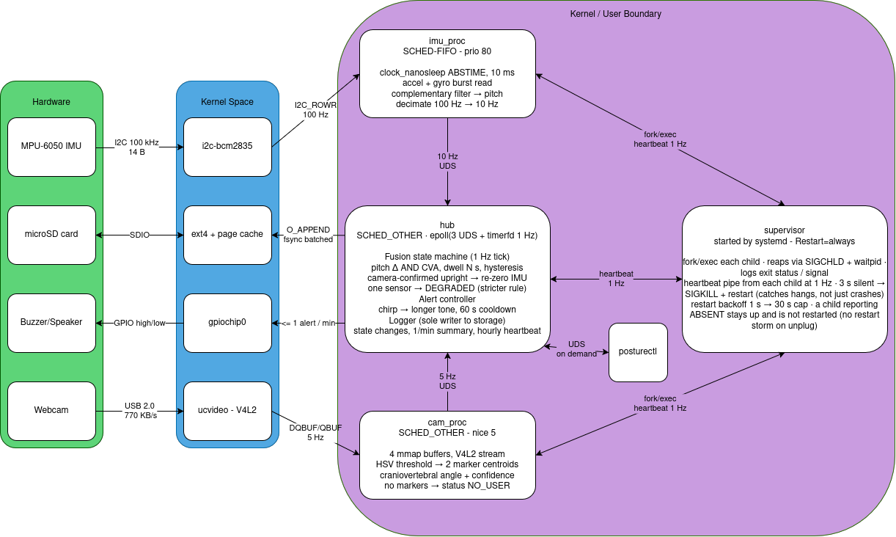

# posture-coach design

# posture-coach design

> Maeve Foster & Tiffany Chen, CS 370. The M2 section below is the submitted **TP-D2 M2 Design Document (10/28/2026)**, imported from `CS-370-001_M2_Design_Document.pdf`. Spelling was corrected; the content is unchanged. Known problems in the submitted text are listed at the end of the M2 section. The M3 section follows it.

## M2 design (TP-D2, 10/28/2026)

### Architecture



Text summary of the diagram (the image is the source of truth):

- **Hardware to kernel:** MPU-6050 IMU over I2C at 100 kHz (14 bytes per read) to `i2c-bcm2835`. Webcam over USB 2.0 (about 770 KB/s) to `ucvideo - V4L2`. Buzzer/speaker through `gpiochip0` (GPIO high/low). microSD card over SDIO through `ext4 + page cache`.
- **`imu_proc`:** `SCHED_FIFO`, priority 80. `clock_nanosleep` with `ABSTIME` at 10 ms. Reads accel + gyro in one burst (`I2C_RDWR`, 100 Hz). Complementary filter gives pitch. Decimates 100 Hz to 10 Hz and sends to `hub` over a Unix domain socket (UDS).
- **`cam_proc`:** `SCHED_OTHER`, nice 5. 4 mmap buffers, V4L2 stream (`DQBUF`/`QBUF`, 5 Hz). HSV threshold finds 2 marker centroids. Computes the craniovertebral angle plus a confidence. No markers gives status `NO_USER`. Sends to `hub` at 5 Hz over UDS.
- **`hub`:** `SCHED_OTHER`. `epoll` over 3 UDS plus a 1 Hz `timerfd`.
  - Fusion state machine (1 Hz tick): pitch change AND CVA, dwell N s, hysteresis. A camera-confirmed upright posture re-zeroes the IMU. One sensor only gives DEGRADED (stricter rule).
  - Alert controller: chirp, then a longer tone, 60 s cooldown, at most 1 alert per minute to `gpiochip0`.
  - Logger (the sole writer to storage): state changes, 1/min summary, hourly heartbeat. Writes with `O_APPEND`, `fsync` batched.
  - `posturectl` talks to `hub` over UDS on demand.
- **`supervisor`:** started by systemd (`Restart=always`). `fork`/`exec` each child, reaps via `SIGCHLD` + `waitpid`, logs exit status and signal. Each child sends a heartbeat through a pipe at 1 Hz. 3 s of silence gives `SIGKILL` + restart (catches hangs, not just crashes). Restart backoff 1 s up to a 30 s cap. A child reporting ABSENT stays up and is not restarted (no restart storm on unplug).

### Mechanism mapping

We will implement both E and C from the menu mechanism given from the handout.

**E (multi-process architecture with a supervisor):** The components used are `imu_proc`, `cam_proc`, `hub`, and `supervisor`. They'll talk over Unix domain sockets, supervisor will use fork/exec and waitpid to catch crashes, and heartbeat timeouts to catch freezes. The supervisor will be kept alive separately by systemd.

- Justification: a posture coach can go silent without warning the user is unreliable. Especially the camera path can lead to the most failure: the USB device can vanish, memory can run out, or the V4L2 buffer dequeue can block forever and make the program freeze. This is why the camera will run as its own program. If one sensor process dies or hangs, the other can keep coaching in a "degraded" mode while the supervisor tracks down the frozen one and restarts it. The supervisor won't be restarting non-stop if the device is unplugged (not crashed), as the program is still alive and labeled as "absent". Restarting wouldn't help hardware that doesn't exist, so the sensor program retries itself, waiting a bit longer each time.

**C (SCHED_FIFO for the IMU sampler):** The IMU thread in `imu_proc` runs at SCHED_FIFO on a 100 Hz timer.

- Justification: The tilt angle is worked out by adding up the chip's spinning speed (gyro) readings over time, then correcting it with the chip's "which way is down" reading (complementary filter). This would work if readings arrived on schedule. However, with the camera process hogging the Pi's four cores sometimes can make the sampler run late. A skipped or late reading makes the angle drift, giving the user false alerts or missed real ones. Thus, we'll need a 10 ms sampling interval with a p99 jitter of 1 ms or less, no gap longer than 20 ms while the camera is running. Since each reading is time-stamped by the Pi's steady clock (CLOCK_MONOTONIC), and the software uses the real time between readings instead of assuming 10 ms. A reading that arrives a little early or late won't corrupt the filter, but a missed reading will, because the angle estimate goes stale. That's why the evaluation counts missed deadlines/long gaps, not just average jitter. We will test C by comparing the default scheduler against SCHED_FIFO, both with the camera idle and running, and report the results even if SCHED_FIFO shows no benefit.

### Failure-mode table

| Failure | How it's detected | What the system does | Log |
| --- | --- | --- | --- |
| IMU unplugged | I2C reads return errors for 5 consecutive tries | `imu_proc` sends back "absent", keeps running, restarts, hub enters degraded | `WARN imu ABSENT i2c_err=5 -> DEGRADED(cam-only)` |
| `imu_proc` killed | Supervisor `waitpid` returns, or the hub sees 2 s with no IMU packet | Supervisor restarts it. Hub degraded until it resumes | `WARN imu_proc exited sig=9; restart #1 in 1s` |
| IMU slips on the shirt | Camera says good posture while IMU pitch stays past baseline for 60 s | Re-zero IMU baseline from cam and log offset | `INFO imu baseline re-zeroed delta=8.2deg` |
| Webcam unplugged | V4L2 open or DQBUF fails with ENODEV | `cam_proc` sends back "absent", retries every 5 seconds, hub enters degraded | `WARN cam ABSENT ENODEV -> DEGRADED(imu-only)` |
| `cam_proc` hung (blocked dequeue) | Missed heartbeat for 3 s | Supervisor sends SIGKILL, restarts process | `ERROR cam_proc heartbeat timeout 3s; SIGKILL; restart #1` |
| Markers occluded or poor light | No marker centroids for 10 s while the IMU shows the user still seated | Camera status "no markers", hub degraded, stricter thresholds | `WARN cam no-markers 10s -> DEGRADED(imu-only)` |
| User leaves the frame | No markers AND large IMU motion | Go to an away state, suppress alerts | `INFO state AWAY` |
| `hub` crash | Supervisor `waitpid`; children's socket closes | Supervisor restarts hub, children reconnect, restarts with calibration | `ERROR hub exited; restart #1; children reconnecting` |
| `supervisor` crash | systemd `Restart=always` | Systemd relaunches, adopts or restarts children | `systemd: supervisor.service restarted` |
| SD card filling | Free space below 10% at the hourly check | Delete oldest logs, log warning, stop writing summaries, keep heartbeats | `WARN disk free=8% rotating logs` |
| Thermal throttling | Read SoC temperature above 80 C at the hourly check | Just log it | `WARN soc_temp=82C throttled` |
| Power loss mid-write | After reboot, the last log line fails its length or checksum check | Ignore the torn last line, continue appending | `INFO recovery: dropped 1 torn line` |
| Speaker/buzzer failure | Not detectable | System can't do anything :( | `INFO alert commanded level=1` |

### Storage and data

- Camera frames will be stored in memory, never saved to the disk.
- An append only log is stored on the disk. The log includes posture state changes, summaries (time upright/slouched), and hourly heartbeats (liveness, RSS, event counts).

### Constraints and substitutions

| Actual | Ideal | Costs |
| --- | --- | --- |
| USB webcam with two colored stickers, our own HSV detection in C | Pose estimation model or depth camera, no markers needed | The user must wear stickers; the detection is sensitive to light, and clothing hiding the neck marker. |
| Wired MPU-6050, about 1 m of twisted pair cable with I2C at 100 kHz for cable length | Wireless wearable IMU | The user will be connected, and the loose cable can be a fault we test on purpose. |
| Scripted sessions by the two of us, plus we replay recorded sensor data through the system | A week of real people sitting at their desks | Replayed data is always labeled as replay. The 48 hour test and the demo use live sensors only. |

### Evaluation plan

- **C: IMU sampling intervals (p50, p99, max) and deadlines**
  - Method: Log timestamps of the 100 Hz samples for 30 minutes. Compare the default scheduler against SCHED_FIFO. Each idle and under camera + `stress-ng` load.
  - Target: p99 jitter at most 1 ms, no gaps over 20 ms under load with FIFO. Deadline misses under 0.01%.
- **E: Recovery after `kill -9` of children**
  - Method: Kill `imu_proc`, `cam_proc`, and `hub` at random times for 10 trials. Measure time from kill to recovery.
  - Target: Detection within 3 seconds, recovery within 5 in at least 9/10 trials.
- **E: Physically unplugging sensors**
  - Method: Unplug during soak and plug back in after 10 minutes.
  - Target: Degraded within 5 seconds, no repeated restarting, full recovery within 10 seconds of replugging.
- **Posture classification**
  - Method: Sessions with timestamped labels of positions. Report a confusion matrix from IMU, camera, and fused.
  - Target: Fused false positive rate below 5%, fused detection at least 85% and better than either sensor on their own.
- **Alert latency**
  - Method: Time between bad posture to speaker/buzzer going off.
  - Target: Go off within 5 seconds of posture check.
- **Resources**
  - Method: CPU% and RSS per process, sampled every minute, plus temperature over the soak.
  - Target: No RSS growth beyond 5% after 2 hours, temperature below 80 Celsius.
- **48 hour soak**
  - Method: Heartbeat every hour with liveness, RSS and event counts, one injected fault in the log.
  - Target: 48 consecutive hours, no unhandled process death.

### Ownership map

- **Maeve Foster:** `imu_proc` (I2C driver code, complementary filter), the hub fusion state machine, calibration. Mechanism C: SCHED_FIFO experiments, the jitter, and deadline-miss measurements.
- **Tiffany Chen:** `cam_proc` (V4L2 capture, HSV marker detection, CVA), supervisor, IPC sockets, logging and recovery. Mechanism E: kill and unplug fault-injection experiments, log recovery test.
- **Both:** `CLAUDE.md`, build and Makefiles, replay harness, classification experiment, evaluation report.

### AI-use plan

**Claude Code:**

- Plan the supervisor: decide when and how the "watcher" program restarts the others.
- Explain V4L2, I2C and epoll: V4L2 is how Linux talks to the camera, I2C is how the Pi talks to the tilt chip, and epoll is a way for a program to wait on several things at once.
- Build the replay harness: a tool that plays recorded sensor data back through our system, so we can test without sitting in front of the camera.
- Generate test fixtures: make labeled sample data to test against.

**Us:** We will write the posture logic ourselves. The HSV detection (code for finding colored stickers in each camera picture), the CVA computation (a formula that turns the two sticker positions into the head-forward angle), and the complementary filter (blending the gyro and "which way is down" readings into one tilt angle). The fusion state machine, which sets rules to decide Good, Slouch, Away, or Degraded from both sensors.

### Known issues in the submitted M2 text

These are listed so the final `DESIGN.md` can record what M2 got wrong (the handout asks for a changelog).

1. The "IMU unplugged" row says `imu_proc` "restarts". The diagram and the E justification say a child that reports ABSENT stays up and is not restarted.
2. The diagram names the camera's no-marker status `NO_USER`; the failure table calls it "no markers". Pick one name.
3. Dwell time N, hysteresis length, posture angle thresholds and the HSV color ranges have no numeric values yet.
4. The Storage section does not give rates, file format, retention or log size cap. The M3 section below defines the log format; retention and size cap are still open.
5. "Within 5 seconds of posture check" does not say which timestamps start and stop the measurement.

## M3 interim decisions (camera only)

The MPU-6050 boards we have are defective, so M3 builds and tests only `cam_proc`. These are deliberate, temporary deviations from the M2 design:

| # | Deviation | M2 design | Reverts when |
|---|---|---|---|
| 1 | `cam_proc` writes the application log itself (`src/common/applog.c`) | Only `hub` persists application logs | hub exists; applog moves into hub |
| 2 | No supervisor, hub or IPC. `cam_proc` is started by hand | supervisor + Unix domain sockets | mechanism E work starts |
| 3 | Log is `./posture.log` in the working directory (`--log PATH` overrides) | `/var/lib/posture/` | systemd deployment |
| 4 | No marker detection. `markers_on_frame()` is an empty, student-owned seam | HSV markers, centroids, CVA | Tiffany implements it |

### Camera capture
- `/dev/video0`, V4L2, YUYV 320×240, 5 fps requested, 4 mmap buffers. The format and frame interval the driver actually grants are logged in `CAM_OPEN` (plus `CAM_FORMAT_MISMATCH` if the size differs).
- Frames stay in the mmap buffers and are requeued right after the callback. Nothing derived from pixels is logged.
- Each dequeue waits at most 1 s (`poll`). A timeout is a stall. 5 consecutive stalls close the device, report `CAM_ABSENT op=stall`, and reopen it immediately.
- Unplug (`ENODEV`/`EIO`/`ENOENT`/`ENXIO`/`EBUSY`, or `POLLERR`) closes the device, logs `CAM_ABSENT` once, and retries every 5 s. Failed retries are counted in `CAM_SUMMARY`, not logged one by one. Reconnecting logs `CAM_RECONNECTED down_ms=…`.
- A wrong device or unsupported format is `CAM_FATAL`: the process exits 1.

### Log format
One record per line:

```
<CLOCK_MONOTONIC s.ns> <UTC ISO-8601 ms> <proc> <EVENT> key=value ... *<crc32>
```

- The CRC-32 (IEEE, lowercase hex) covers every byte before ` *`. Records are at most 512 bytes; an oversized body is replaced by `truncated=1`. CR/LF in values become `_`.
- Each record goes out in one `write()` on an `O_APPEND` fd. A failed write is truncated back out of the file.
- On open, an unterminated tail is dropped, then the final complete line is dropped if its CRC fails. A `LOG_TORN_REPAIRED bytes=N` record follows.
- Events: `CAM_START`, `CAM_OPEN`, `CAM_FORMAT_MISMATCH`, `CAM_SUMMARY`, `CAM_STALL`, `CAM_ABSENT`, `CAM_RECONNECTED`, `CAM_FATAL`, `CAM_STOP`, `HEALTH` (hourly: uptime, RSS, totals), `LOG_TORN_REPAIRED`, `LOG_ROTATED`.

### Open decisions (placeholders, team to confirm)
| Item | Placeholder | Where |
|---|---|---|
| Log size cap | 5 MiB, plus one rotated copy `posture.log.1` (about 10 MiB worst case) | `APPLOG_CAP` in `src/common/applog.h` |
| Summary interval | 10 s (per-frame lines would be about 430k/day) | `CAM_SUMMARY_S` in `src/cam_proc/main.c` |
| Whether one rotated `.1` copy fits "single log file" | allowed | `applog.c` `rotate()` |
| Disk-space (<10%) and thermal checks | not in cam_proc; belong to hub | — |

## M3 interim decisions (camera only)

The MPU-6050 boards we have are defective, so M3 builds and tests only `cam_proc`. These are deliberate, temporary deviations from the M2 design:

| # | Deviation | M2 design | Reverts when |
|---|---|---|---|
| 1 | `cam_proc` writes the application log itself (`src/common/applog.c`) | Only `hub` persists application logs | hub exists; applog moves into hub |
| 2 | No supervisor, hub or IPC. `cam_proc` is started by hand | supervisor + Unix domain sockets | mechanism E work starts |
| 3 | Log is `./posture.log` in the working directory (`--log PATH` overrides) | `/var/lib/posture/` | systemd deployment |
| 4 | No marker detection. `markers_on_frame()` is an empty, student-owned seam | HSV markers, centroids, CVA | Tiffany implements it |

### Camera capture
- `/dev/video0`, V4L2, YUYV 320×240, 5 fps requested, 4 mmap buffers. The format and frame interval the driver actually grants are logged in `CAM_OPEN` (plus `CAM_FORMAT_MISMATCH` if the size differs).
- Frames stay in the mmap buffers and are requeued right after the callback. Nothing derived from pixels is logged.
- Each dequeue waits at most 1 s (`poll`). A timeout is a stall. 5 consecutive stalls close the device, report `CAM_ABSENT op=stall`, and reopen it immediately.
- Unplug (`ENODEV`/`EIO`/`ENOENT`/`ENXIO`/`EBUSY`, or `POLLERR`) closes the device, logs `CAM_ABSENT` once, and retries every 5 s. Failed retries are counted in `CAM_SUMMARY`, not logged one by one. Reconnecting logs `CAM_RECONNECTED down_ms=…`.
- A wrong device or unsupported format is `CAM_FATAL`: the process exits 1.

### Log format
One record per line:

```
<CLOCK_MONOTONIC s.ns> <UTC ISO-8601 ms> <proc> <EVENT> key=value ... *<crc32>
```

- The CRC-32 (IEEE, lowercase hex) covers every byte before ` *`. Records are at most 512 bytes; an oversized body is replaced by `truncated=1`. CR/LF in values become `_`.
- Each record goes out in one `write()` on an `O_APPEND` fd. A failed write is truncated back out of the file.
- On open, an unterminated tail is dropped, then the final complete line is dropped if its CRC fails. A `LOG_TORN_REPAIRED bytes=N` record follows.
- Events: `CAM_START`, `CAM_OPEN`, `CAM_FORMAT_MISMATCH`, `CAM_SUMMARY`, `CAM_STALL`, `CAM_ABSENT`, `CAM_RECONNECTED`, `CAM_FATAL`, `CAM_STOP`, `HEALTH` (hourly: uptime, RSS, totals), `LOG_TORN_REPAIRED`, `LOG_ROTATED`.

### Open decisions (placeholders, team to confirm)
| Item | Placeholder | Where |
|---|---|---|
| Log size cap | 5 MiB, plus one rotated copy `posture.log.1` (about 10 MiB worst case) | `APPLOG_CAP` in `src/common/applog.h` |
| Summary interval | 10 s (per-frame lines would be about 430k/day) | `CAM_SUMMARY_S` in `src/cam_proc/main.c` |
| Whether one rotated `.1` copy fits "single log file" | allowed | `applog.c` `rotate()` |
| Disk-space (<10%) and thermal checks | not in cam_proc; belong to hub | — |
